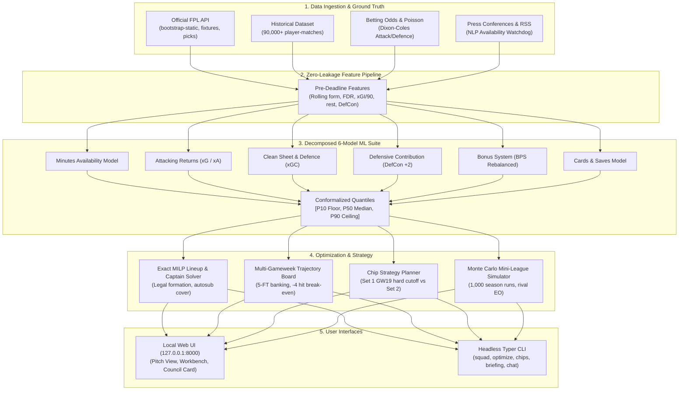

# ⚽ FPL Oracle (2026/27)

> **Autonomous, Machine-Learning-Driven Fantasy Premier League Decision Support Engine & Conversational Analyst**

[](https://www.python.org/downloads/)
[](https://fastapi.tiangolo.com/)
[](https://lightgbm.readthedocs.io/)
[](https://coin-or.github.io/pulp/)
[](#zero-key-offline-operation)
[](LICENSE)

**FPL Oracle** is an enterprise-grade, privacy-first decision support system and conversational AI expert designed specifically for the **Fantasy Premier League 2026/27** campaign. 

Running 100% locally on your machine, it synthesizes historical match data across 90,000+ performances, live official Premier League telemetry, and bookmaker odds to compute mathematically optimal transfer plans, lineup selections, captaincy picks, and chip strategies.

---

## 🌟 Key Features

- **🧠 Decomposed 6-Model ML Suite**: Specialized LightGBM models predict Minutes Availability, Attacking Returns (xG/xA), Clean Sheets & Defensive Actions (xGC), Defensive Contribution points (+2 DefCon), Bonus Points System (BPS), and Cards/Saves with out-of-fold calibrated $[P_{10}, P_{50}, P_{90}]$ credible intervals.
- **⚡ Exact Mixed-Integer Linear Programming (MILP)**: PuLP/CBC optimization engine solves legal XI formations, vice-captain failsafes, 5-week transfer roadmaps, banked free transfers (up to 5 FTs), and four-point hit break-even dynamics.
- **🛡️ Game-Theoretic Mini-League Strategy**: Proximity-based rival tracking with 1,000 Monte Carlo season runs, dynamically toggling between *Template Shield* (protecting your lead) and *Differential Chaser* (closing point gaps).
- **🏆 Native 2026/27 Rules Engine**: Built specifically for 2026/27 Premier League rule additions—up to 5 banked free transfers, Set 1 GW1–19 hard chip cutoff, outfield DefCon (+2 bonus points for CBIT/CBIRT thresholds), and rebalanced BPS scoring.
- **📰 Gated NLP Team News Watchdog**: Scans official press conferences and Premier League injury data, citing verbatim quotes before modifying minutes expectations.
- **💬 Zero-Key Conversational AI Expert**: Operates 100% offline out of the box with built-in heuristic decision trees; optionally connects to Google Gemini, Anthropic Claude, or OpenAI GPT for natural language explanations.
- **💻 Modern Editorial UI & Headless CLI**: Responsive dark-mode dashboard (Pitch view, interactive autosub simulator, Transfer Workbench, Chip Roadmap, Mini-League Intelligence, Pre-deadline Audit checklist) plus a full CLI.

---

## 🏗️ System Architecture



---

## 🚀 Quickstart

### Prerequisites
- **Python 3.11+**
- Windows, macOS, or Linux
- Internet connection (for public FPL API sync on first run)

### Windows (One-Command Launch)
From your terminal:
```powershell
powershell -ExecutionPolicy Bypass -File .\start.ps1
```
The launcher automatically provisions the `.venv` virtual environment, verifies dependencies, checks the PuLP/CBC solver, and launches your browser to **`http://127.0.0.1:8000`**.

### macOS / Linux
```bash
# 1. Environment setup & dependency installation
python run.py setup

# 2. Run system verification
python run.py verify

# 3. Launch the local web server
python run.py run
```
*(Or use `make setup`, `make verify`, `make run`)*

---

## ⚙️ Configuration & Zero-Key Operation

FPL Oracle runs **100% locally with zero external API keys**.

1. Copy the example configuration:
   ```bash
   cp .env.example .env
   ```
2. Open `.env` and set your public FPL Manager ID and target Mini-League ID:
   ```ini
   FPL_MANAGER_ID=1234567
   FPL_TARGET_LEAGUE_ID=987654
   ```
   *(No passwords or private credentials are ever requested or stored).*

### Optional AI Keys
If you want rich conversational chat with natural language explanations:
- **Google Gemini**: Set `GEMINI_API_KEY` in `.env` (default provider).
- **Anthropic Claude**: Set `ANTHROPIC_API_KEY` and `LLM_PROVIDER=anthropic`.
- **OpenAI GPT**: Set `OPENAI_API_KEY` and `LLM_PROVIDER=openai`.
- **Offline Expert**: Set `LLM_PROVIDER=offline` (uses local rule-based intelligence; zero network calls).

---

## 📋 Recommended Gameweek Workflow

Follow this 5-step checklist before each gameweek deadline:

1. **Sync Team State**: Launch `.\start.ps1` and verify your bank, free transfers (1–5), and current squad.
2. **Review "Your Next Decision"**: Inspect the Council Decision Card on the Overview tab for optimal transfers, captain, and bench choices.
3. **Check Availability Radar**: Review press-conference alerts on Thursday/Friday for injury updates and training news.
4. **Run Pre-Deadline Audit**: Click the **Audit** button in the header to check formation legality, captaincy, vice-captain failsafes, and bench order.
5. **Execute in FPL**: Manually apply your confirmed moves in the official FPL app or website.

---

## 🖥️ Command Line Interface (CLI)

Prefer the terminal? Run any analysis instantly:

```bash
# View projected starting XI, captaincy, and fixture difficulty
python run.py cli squad --manager-id 1234567

# Calculate optimal multi-gameweek transfer roadmap
python run.py cli optimize --manager-id 1234567 --horizon 3

# Compute optimal chip schedule across all 38 gameweeks
python run.py cli chips --manager-id 1234567

# Analyze mini-league standings, rival differentials, and win probability
python run.py cli analyze --league-id 987654 --manager-id 1234567

# Generate full weekly briefing report
python run.py cli briefing --manager-id 1234567

# Launch conversational terminal chat
python run.py cli chat
```

---

## 📁 Repository Structure

```
fpl-oracle/
├── config/              # YAML rules, scoring weights, news sources, settings
├── data/
│   ├── historical/      # Multi-season historical match logs (vaastav dataset)
│   ├── models/          # Production LightGBM model weights and calibration
│   └── odds/            # Implied bookmaker odds (clean sheet, goalscorer)
├── docs/                # Architectural specifications and mathematical models
│   ├── decision_model.md        # Exact formulas (xP, MILP, risk, DefCon)
│   └── system_architecture.md   # End-to-end system and algorithmic specification
├── reports/             # Model evaluation summaries, backtests, and track records
├── scripts/             # Verification suites, maintenance tools, and audit scripts
├── src/fpl_oracle/      # Core package source code
│   ├── advisor/         # Decision cards, transfer critique, timing, funding
│   ├── api/             # Official FPL API client, caching, rule checker
│   ├── briefing/        # Weekly report and decision card synthesis
│   ├── chips/           # Chip strategy planner and dynamic simulator
│   ├── data/            # Feature engineering, store, fuzzy matching, player identity
│   ├── domain/          # Manager state, scoring contracts, ensemble definitions
│   ├── league/          # Mini-league Monte Carlo, rivals, strategy, live matchday
│   ├── llm/             # Provider-agnostic chat (Gemini, Claude, GPT, Offline)
│   ├── ml/              # 6-model LightGBM suite, calibration, prediction, temporal
│   ├── news/            # NLP press conference parser, leak watchdog, local NLP
│   ├── optimise/        # PuLP CBC MILP optimizer, trajectory board, covariance
│   └── server/          # FastAPI application, background scheduler, REST routes
├── tests/               # Comprehensive pytest test suite (100% offline fixtures)
├── web/                 # Fast, dependency-free dark-mode single page web interface
├── pyproject.toml       # Python package configuration, dependencies, tool settings
├── run.py               # Cross-platform runner script (setup, run, train, test, cli)
└── start.ps1            # One-click Windows PowerShell launcher
```

---

## 🧪 Development & Quality Checks

Run the automated verification suite before submitting pull requests:

```bash
# Code formatting & linting
python -m ruff check src tests scripts
python -m ruff format --check src tests scripts

# Static type checking
python -m mypy src

# Fast test suite (< 30 seconds)
python -m pytest -m "not slow"

# Security & secrets scan
python scripts/check_secrets.py

# End-to-end subsystem verification
python run.py verify
```

---

## 📖 Further Documentation

- **[USER_GUIDE.md](USER_GUIDE.md)**: Full walkthrough of the web UI, autosub simulation, and plain-English terminology guide.
- **[SETUP.md](SETUP.md)**: Complete setup manual, troubleshooting guide, finding manager IDs, and manual squad upload.
- **[docs/system_architecture.md](docs/system_architecture.md)**: Comprehensive technical and algorithmic specification.
- **[docs/decision_model.md](docs/decision_model.md)**: Exact mathematical formulas for point projections, MILP constraints, and Monte Carlo simulations.

---

## 🔒 Advisory Boundary & Responsible Use

> **Important**: FPL Oracle is an **advisory tool only**. It runs locally on your machine, reads public FPL data, and does not require or store your FPL account password. It **never submits transfers, chips, or team changes on your behalf**. All recommendations must be confirmed and executed manually by you on the official Fantasy Premier League website or app.

---

## 📄 License

Distributed under the MIT License. See `LICENSE` for details.
