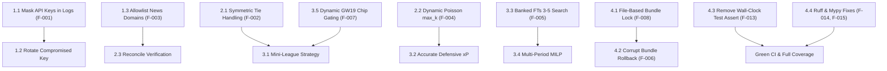

# Remediation & Fix Plan

This document defines a dependency-aware, prioritized remediation plan to resolve all 16 audit findings discovered during the adversarial audit of `fpl-oracle`.



---

## Phase 1: Critical Security & Integrity Hotfixes (Immediate — Day 1)

### Item 1.1: Mask Plaintext API Keys in HTTP Logging
- **Addresses Finding:** F-001
- **Severity:** CRITICAL
- **Files:** [`src/fpl_oracle/utils/logging.py`](file:///C:/Users/anshw/Documents/fpl-oracle/src/fpl_oracle/utils/logging.py), [`src/fpl_oracle/config.py`](file:///C:/Users/anshw/Documents/fpl-oracle/src/fpl_oracle/config.py)
- **Actions:**
  1. Set `logging.getLogger("httpx").setLevel(logging.WARNING)` and `logging.getLogger("httpcore").setLevel(logging.WARNING)`.
  2. Implement a `SecretFilter(logging.Filter)` that regex-redacts any URL parameter `(?<=key=)[^&\s]+` with `[REDACTED]`.
  3. Purge existing plaintext keys from `logs/fpl_oracle.log` and rotate the active Google AI Studio Gemini API key.
- **Verification:** Run a sample LLM news extraction script; verify logs contain no raw API key string.

### Item 1.2: Restrict News Ingestion to Verified Domains (Prompt Injection Defense)
- **Addresses Finding:** F-003
- **Severity:** CRITICAL
- **Files:** [`src/fpl_oracle/news/reconcile.py`](file:///C:/Users/anshw/Documents/fpl-oracle/src/fpl_oracle/news/reconcile.py), [`config/news_sources.yaml`](file:///C:/Users/anshw/Documents/fpl-oracle/config/news_sources.yaml)
- **Actions:**
  1. Add an explicit `trusted_publishers: list[str]` allowlist in `config/news_sources.yaml`.
  2. In `reconcile.py`, reject any article whose origin domain is not on the allowlist before allowing Gated-Active availability overrides.
  3. Require corroboration from 2 independent verified sources before setting `effective_chance_of_playing = 0.0`.
- **Verification:** Run [`audit/scratch/test_prompt_injection.py`](file:///C:/Users/anshw/Documents/fpl-oracle/audit/scratch/test_prompt_injection.py); confirm untrusted quotes are rejected.

---

## Phase 2: Core Mathematical & Simulation Correctness (Week 1)

### Item 2.1: Symmetric Monte Carlo Rank Tie-Breaking
- **Addresses Finding:** F-002
- **Severity:** CRITICAL
- **Dependencies:** None
- **Files:** [`src/fpl_oracle/league/montecarlo.py:414`](file:///C:/Users/anshw/Documents/fpl-oracle/src/fpl_oracle/league/montecarlo.py#L414)
- **Actions:**
  1. Modify rank accumulation in `simulate_league_ranks`:
     ```python
     strictly_ahead = sum(1 for s in all_scores if s > trial_user_pts)
     tied_count = sum(1 for s in all_scores if s == trial_user_pts)
     user_rank = strictly_ahead + 1  # Standard min-rank for reporting
     win_credit = 1.0 / (1 + tied_count) if strictly_ahead == 0 else 0.0
     ```
  2. Accumulate fractional win credits across trials so two identical teams each receive exactly 50.0% win probability.
- **Verification:** Run [`audit/scratch/test_symmetric_tie.py`](file:///C:/Users/anshw/Documents/fpl-oracle/audit/scratch/test_symmetric_tie.py); confirm 50.0% output on identical rosters.

### Item 2.2: Dynamic Poisson Summation Upper Bound
- **Addresses Finding:** F-004
- **Severity:** HIGH
- **Dependencies:** None
- **Files:** [`src/fpl_oracle/domain/scoring.py:95-107`](file:///C:/Users/anshw/Documents/fpl-oracle/src/fpl_oracle/domain/scoring.py#L95-L107)
- **Actions:**
  1. Replace hardcoded `max_k = 20` with dynamic bound:
     ```python
     dynamic_k = max(40, int(rate + 6.0 * math.sqrt(rate)))
     ```
  2. Or sum until Poisson PMF drops below `1e-9`.
- **Verification:** Run [`audit/scratch/test_poisson_and_probability.py`](file:///C:/Users/anshw/Documents/fpl-oracle/audit/scratch/test_poisson_and_probability.py); confirm expectations match brute-force calculations across `rate in [0.1, 50.0]`.

---

## Phase 3: Optimiser & Chip Strategy Upgrades (Week 2)

### Item 3.1: Expand Transfer Search for Banked 3–5 Free Transfers
- **Addresses Finding:** F-005
- **Severity:** HIGH
- **Dependencies:** None
- **Files:** [`src/fpl_oracle/optimise/sequential.py`](file:///C:/Users/anshw/Documents/fpl-oracle/src/fpl_oracle/optimise/sequential.py), [`src/fpl_oracle/optimise/transfers.py`](file:///C:/Users/anshw/Documents/fpl-oracle/src/fpl_oracle/optimise/transfers.py)
- **Actions:**
  1. Add `_get_candidate_3_transfers` and `_get_candidate_N_transfers` when `banked_fts >= N`.
  2. Or introduce exact multi-period MILP solver (`multiperiod.py`) as recommended in `fpl_oracle_improvement_spec.md`.
- **Verification:** Run sequential search with 5 banked FTs; verify the solver evaluates and discovers 3- and 4-player hit-free moves.

### Item 3.2: Dynamic GW19 Set 1 Chip Gating (Option-Value Logic)
- **Addresses Finding:** F-007
- **Severity:** HIGH
- **Dependencies:** Item 2.1
- **Files:** [`src/fpl_oracle/chips/planner.py:356-358`](file:///C:/Users/anshw/Documents/fpl-oracle/src/fpl_oracle/chips/planner.py#L356-L358)
- **Actions:**
  1. Make threshold dynamic:
     ```python
     effective_threshold = 0.0 if rec_gw == 19 else CHIP_RECOMMENDATION_THRESHOLDS.get(c, 8.0)
     is_recommended = (gain > effective_threshold) and (rec_gw == current_gw)
     ```
  2. Ensure all unplayed Set 1 chips are scheduled before or at GW19 as long as expected gain is positive.
- **Verification:** Run Scenario 4 in [`audit/scratch/run_scenarios.py`](file:///C:/Users/anshw/Documents/fpl-oracle/audit/scratch/run_scenarios.py); verify chips are recommended and not forfeited.

### Item 3.3: Risk Posture Formulation in Starting Lineup Solver
- **Addresses Finding:** F-011
- **Severity:** MEDIUM
- **Dependencies:** None
- **Files:** [`src/fpl_oracle/optimise/lineup.py:65-71`](file:///C:/Users/anshw/Documents/fpl-oracle/src/fpl_oracle/optimise/lineup.py#L65-L71)
- **Actions:**
  1. Incorporate downside risk (`p10`) into starter objective coefficients:
     ```python
     if risk_preference == "conservative":
         starter_score = df["expected_points"] * 0.70 + df["p10"] * 0.30
     elif risk_preference == "aggressive":
         starter_score = df["expected_points"] * 0.70 + df["p90"] * 0.30
     else:
         starter_score = df["expected_points"]
     ```
- **Verification:** Run Scenario 8 in [`audit/scratch/run_scenarios.py`](file:///C:/Users/anshw/Documents/fpl-oracle/audit/scratch/run_scenarios.py); verify conservative mode benches high-variance doubtful starters.

---

## Phase 4: Model Quality, Concurrency & CI Hardening (Week 3)

### Item 4.1: Cross-Process File Lock for Model Promotions
- **Addresses Finding:** F-008
- **Severity:** HIGH
- **Files:** [`src/fpl_oracle/ml/bundle_lock.py`](file:///C:/Users/anshw/Documents/fpl-oracle/src/fpl_oracle/ml/bundle_lock.py)
- **Actions:**
  1. Replace `threading.RLock()` with `filelock.FileLock("data/models/bundle.lock")`.
- **Verification:** Spawn concurrent worker processes attempting bundle swaps; verify atomic serialization without corruption.

### Item 4.2: Automatic Checkpoint Recovery on Corrupt Bundle
- **Addresses Finding:** F-006
- **Severity:** HIGH
- **Dependencies:** Item 4.1
- **Files:** [`src/fpl_oracle/ml/predict.py`](file:///C:/Users/anshw/Documents/fpl-oracle/src/fpl_oracle/ml/predict.py), [`src/fpl_oracle/ml/model_registry.py`](file:///C:/Users/anshw/Documents/fpl-oracle/src/fpl_oracle/ml/model_registry.py)
- **Actions:**
  1. Catch `ValueError` in `predict.py:load_active_bundle()`.
  2. On corruption, invoke `model_registry.rollback_to_last_valid_checkpoint()` automatically.
- **Verification:** Run [`audit/scratch/test_corrupt_bundle.py`](file:///C:/Users/anshw/Documents/fpl-oracle/audit/scratch/test_corrupt_bundle.py); verify automatic recovery.

### Item 4.3: Disambiguate Surnames in Entity Resolution
- **Addresses Finding:** F-010
- **Severity:** MEDIUM
- **Files:** [`src/fpl_oracle/data/fuzzy_match.py`](file:///C:/Users/anshw/Documents/fpl-oracle/src/fpl_oracle/data/fuzzy_match.py)
- **Actions:**
  1. Match on full name and club context; penalize ambiguous matches where multiple players match the token.
- **Verification:** Run [`audit/scratch/test_same_surname.py`](file:///C:/Users/anshw/Documents/fpl-oracle/audit/scratch/test_same_surname.py); confirm ambiguity penalty.

### Item 4.4: Remove Flaky Wall-Clock Assertion & Clean Linters
- **Addresses Findings:** F-013, F-014, F-015, F-016
- **Severity:** MEDIUM / LOW
- **Files:** [`tests/test_league_strategy_mc.py:370`](file:///C:/Users/anshw/Documents/fpl-oracle/tests/test_league_strategy_mc.py#L370), various `src/` files
- **Actions:**
  1. Remove `assert elapsed < 2.0` in `test_league_strategy_mc.py`.
  2. Run `ruff check --fix .` and resolve 7 mypy errors.
  3. Update doc references from 57 to 62 features.
- **Verification:** Execute `pytest`, `ruff check .`, and `mypy src`; verify 100% clean exit codes.
