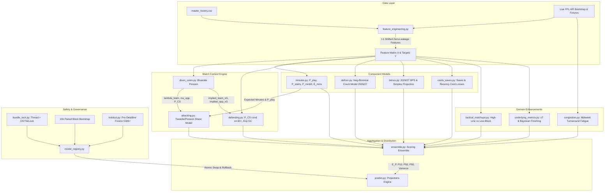

# Comprehensive Machine Learning & Projections Engine Audit Report
**FPL Oracle Predictive Modeling Subsystem**  
**Audit Date:** October 29, 2026  
**Auditor:** Machine Learning & Projections Auditor  
**Audit Scope:** `src/fpl_oracle/ml/` and `tests/ml/`  
**Test Suite Status:** 64 passed, 3 deselected in 46.56s (0:00:46)

---

## 1. Executive Summary & Architectural Topology

The **FPL Oracle Predictive Modeling Subsystem** implements a highly modular, decomposed component architecture rather than an opaque, end-to-end monolithic regression model. This architectural choice provides decisive advantages:
1. **Mathematical Coherence & Boundary Guarantees:** Physical and probabilistic invariants (e.g. clean sheet scoring requiring 60+ minutes, fixture-level bonus points strictly summing to $\le 6.0$, player goal shares summing to team expected goals) are enforced structurally rather than left to unconstrained gradient-boosted trees.
2. **Modular Calibration:** Individual components (playing probabilities, clean sheet odds, DefCon thresholds) are calibrated out-of-fold via Isotonic regression or Platt scaling without distorting the underlying event count models.
3. **Exact Rule Era Invariance:** Complex rule changes—specifically the official Premier League 2026/27 introduction of Defensive Contribution (+2 points for DEF $\ge 10$ CBIT, MID/FWD $\ge 12$ CBIRT) and BPS rebalancing (tackled penalty removed, CBI 1 BPS per 3 actions, GK 2 BPS per save)—are accommodated cleanly without retraining historical components from scratch.
4. **Transparent Baselines & Automated Guardrails:** Model promotion is strictly evidence-gated by zero-tolerance degradation checks against three transparent heuristic baselines, rolling-origin cross-validation, and a 10,000-resample paired block-bootstrap over gameweeks.



---

## 2. File-by-File Technical Deep Dive

### 2.1 `src/fpl_oracle/ml/bundle_lock.py`
- **Purpose:** Thread-level and cross-process operating system file lock coordinating inference, loading, staging, promotion, and rollback operations.
- **Key Mechanics:**
  - `BUNDLE_THREAD_LOCK = RLock()` ([L11](file:///C:/Users/anshw/Documents/fpl-oracle/src/fpl_oracle/ml/bundle_lock.py#L11)): In-process reentrant lock guarding multi-threaded execution within the FastAPI/Uvicorn server.
  - `get_bundle_file_lock(target_dir, timeout=30.0)` ([L17-24](file:///C:/Users/anshw/Documents/fpl-oracle/src/fpl_oracle/ml/bundle_lock.py#L17-L24)): Uses `filelock.FileLock` anchored to `MODELS_DIR / "bundle.lock"` with a 30-second acquisition timeout and an in-memory `_LOCK_CACHE` to avoid duplicate file descriptor leaks.
  - `@bundle_locked` ([L27-44](file:///C:/Users/anshw/Documents/fpl-oracle/src/fpl_oracle/ml/bundle_lock.py#L27-L44)): Decorator that dynamically resolves `target_dir` from the calling instance's `models_dir` attribute (or defaults to `MODELS_DIR`), acquiring the OS lock inside the thread lock.
- **Verification:** Prevents race conditions during atomic weight swaps, corruption quarantine, and concurrent prediction inference.

---

### 2.2 `src/fpl_oracle/ml/temporal.py`
- **Purpose:** Chronological expanding-window cross-validation generator with indivisible season/gameweek blocks.
- **Key Mechanics:**
  - `_season_round_sort_key(group)` ([L3-16](file:///C:/Users/anshw/Documents/fpl-oracle/src/fpl_oracle/ml/temporal.py#L3-L16)): Extracts an integer tuple `(start_year, round)` from heterogeneous season representations (e.g. `'2025-26'`, `'2025/26'`, `'2025'`, `'25-26'`).
  - `temporal_folds(X, n_splits=3)` ([L19-52](file:///C:/Users/anshw/Documents/fpl-oracle/src/fpl_oracle/ml/temporal.py#L19-L52)): Reads `X.attrs["meta"]` containing aligned `season` and `round` metadata. Splits unique chronological blocks using `np.array_split`.
- **Temporal Invariant:** Strictly guarantees that for every fold $i$, `group_ranks < cutoff_rank` (training set) precedes `group_ranks >= cutoff_rank` (validation set). Matches within the same gameweek are never split across train and test boundaries.

---

### 2.3 `src/fpl_oracle/ml/calibration.py`
- **Purpose:** Probability calibration and scoring diagnostics (Brier score, Log-Loss).
- **Key Mechanics:**
  - `Calibrator` ([L15-76](file:///C:/Users/anshw/Documents/fpl-oracle/src/fpl_oracle/ml/calibration.py#L15-L76)): Supports `"isotonic"` (`sklearn.isotonic.IsotonicRegression(out_of_bounds="clip", y_min=0.0, y_max=1.0)`) and `"platt"` (`sklearn.linear_model.LogisticRegression(C=1e5, solver="lbfgs")` on the logit).
  - Platt slope constraint ([L29-34](file:///C:/Users/anshw/Documents/fpl-oracle/src/fpl_oracle/ml/calibration.py#L29-L34)): Enforces monotonicity by forcing non-negative slope:
    ```python
    if lr.coef_[0, 0] < 0:
        lr.coef_[0, 0] = 0.0
        base_rate = float(np.clip(np.mean(y_true), 1e-6, 1.0 - 1e-6))
        lr.intercept_[0] = float(np.log(base_rate / (1.0 - base_rate)))
    ```
    This completely eliminates probability inversions on small calibration sets.
  - Metrics: Implements numerically stable Brier score $\frac{1}{N}\sum(p - y)^2$ and cross-entropy log-loss $-\frac{1}{N}\sum [y \ln(p) + (1-y)\ln(1-p)]$ with $\epsilon = 10^{-15}$ clipping.

---

### 2.4 `src/fpl_oracle/ml/components/base.py`
- **Purpose:** Abstract Base Class (`BaseComponent`) defining component model serialization contracts ([L13-33](file:///C:/Users/anshw/Documents/fpl-oracle/src/fpl_oracle/ml/components/base.py#L13-L33)).
- **Key Mechanics:** Defines abstract `fit(X, Y)` and `predict(X) -> dict[str, np.ndarray]`, along with pickle-based `save(filepath)` and `load(filepath)` methods.

---

### 2.5 `src/fpl_oracle/ml/components/dixon_coles.py`
- **Purpose:** Bivariate Dixon-Coles (1997) match scoreline and team strength model with low-score correlation parameter $\rho$, time-decay weighting $\xi$, zero-sum parameter identifiability, and promoted club priors.
- **Key Mechanics:**
  - `_smooth_log_tau(tau, eps=1e-4)` ([L24-35](file:///C:/Users/anshw/Documents/fpl-oracle/src/fpl_oracle/ml/components/dixon_coles.py#L24-L35)): Twice-differentiable $C^2$ quadratic barrier penalty replacing non-smooth clamping. When $\tau < \epsilon$:
    $$\text{quad\_ext}(\tau) = \ln(\epsilon) + \frac{\tau - \epsilon}{\epsilon} - \frac{1}{2}\left(\frac{\tau - \epsilon}{\epsilon}\right)^2$$
    Guarantees continuous gradients and positive-definite Hessian during L-BFGS-B optimization.
  - Zero-Sum Identifiability ([L177-186](file:///C:/Users/anshw/Documents/fpl-oracle/src/fpl_oracle/ml/components/dixon_coles.py#L177-L186)):
    $$\alpha_0 = -\sum_{i=1}^{N-1} u_i, \quad \alpha_{1..N-1} = u$$
    $$\delta_0 = -\sum_{i=1}^{N-1} v_i, \quad \delta_{1..N-1} = v$$
    Eliminates the degenerate zero-eigenvalue Hessian direction where $\alpha \to \alpha + c, \delta \to \delta + c$.
  - Objective Function ([L170-203](file:///C:/Users/anshw/Documents/fpl-oracle/src/fpl_oracle/ml/components/dixon_coles.py#L170-L203)):
    $$\mathcal{L} = -\sum_{m=1}^M w_m \left[ h_m \ln \lambda_m - \lambda_m + a_m \ln \mu_m - \mu_m + \ln \tau_\rho(h_m, a_m, \lambda_m, \mu_m) \right] + \lambda_{\text{ridge}} \left( \sum \alpha_i^2 + \sum \delta_i^2 \right)$$
    where $w_m = e^{-\xi \Delta t_m} / \bar{w}$ with half-life set by $\xi = 0.001$.
  - Promoted Club Priors ([L63-70, 228-235](file:///C:/Users/anshw/Documents/fpl-oracle/src/fpl_oracle/ml/components/dixon_coles.py#L63-L70)): Fitted from historical promoted clubs (mean $\alpha = -0.290$, mean $\delta = -0.568$, representing weaker attack and higher goals conceded). Dynamically updated on refit from the bottom tercile of established teams.
  - Clean Sheet Recalibration ([L236-262](file:///C:/Users/anshw/Documents/fpl-oracle/src/fpl_oracle/ml/components/dixon_coles.py#L236-L262)): Fits an Isotonic Calibrator on raw Poisson zero-goal probabilities, blended with empirical shrinkage:
    $$P(\text{CS})_{\text{final}} = \text{clip}(0.85 \cdot P(\text{CS})_{\text{iso}} + 0.15 \cdot 0.28, 0.02, 0.75)$$

---

### 2.6 `src/fpl_oracle/ml/components/attacking.py`
- **Purpose:** Player attacking expectation model and coherent team-goal reconciliation engine (WI-3.3).
- **Key Mechanics:**
  - `share_offset(X, minutes, target)` ([L36-58](file:///C:/Users/anshw/Documents/fpl-oracle/src/fpl_oracle/ml/components/attacking.py#L36-L58)): Analytical Bayesian prior offset:
    $$\text{offset} = \ln\left(\lambda_{\text{team}} \cdot \text{share}_{30} \cdot \text{pos\_rate}\right) + 0.5 \ln\left(\frac{\text{conv}_{30}}{\text{norm}}\right) + \ln\left(\frac{\min(90, \max(1, \text{mins}))}{90}\right)$$
    Position conversion multipliers (`GOALS_PER_XG`): GKP 0.01, DEF 0.849, MID 1.005, FWD 0.978.
  - Tree Learning ([L60-109](file:///C:/Users/anshw/Documents/fpl-oracle/src/fpl_oracle/ml/components/attacking.py#L60-L109)): LightGBM Poisson regressors (`learning_rate=0.03, num_leaves=15, min_child_samples=100, n_estimators=4000`) fit with `init_score=offset` on rows where `target_minutes > 0`. The booster learns a multiplicative correction factor around the prior: $\mathbb{E}[Y] = \exp(\text{offset} + f(X))$.
  - Bookmaker Margin Power Method ([L111-158](file:///C:/Users/anshw/Documents/fpl-oracle/src/fpl_oracle/ml/components/attacking.py#L111-L158)): Solves for exponent $k \in [1.0, 8.0]$ via bisection such that:
    $$\sum_{i \in \text{priced}} w_i \left[ -\ln(1 - p_i^k) \right] = \max(\lambda_{\text{goals}} - \text{unpriced}, 0.25 \lambda_{\text{goals}})$$
  - Team Goal & Assist Reconciliation ([L160-294](file:///C:/Users/anshw/Documents/fpl-oracle/src/fpl_oracle/ml/components/attacking.py#L160-L294)): Multiplicative scaling factors $\kappa_g, \kappa_a$ enforce team totals per fixture:
    $$\sum_{p \in \text{team}} \text{avail}_p \cdot \mathbb{E}[\text{goals}_p] = 0.963 \cdot \lambda_{\text{team}}$$
    $$\sum_{p \in \text{team}} \text{avail}_p \cdot \mathbb{E}[\text{assists}_p] = 0.879 \cdot \lambda_{\text{team}}$$
    Guards against single-player evaluation queries (`len(idx) < 3`) to prevent allocating full team goals to one player.

---

### 2.7 `src/fpl_oracle/ml/components/defending.py`
- **Purpose:** Clean sheet probability and expected goals conceded model.
- **Key Mechanics:**
  - Conditional Clean Sheet Training ([L37-41](file:///C:/Users/anshw/Documents/fpl-oracle/src/fpl_oracle/ml/components/defending.py#L37-L41)):
    ```python
    played_60 = Y["target_min60"].to_numpy() > 0 if "target_min60" in Y.columns else np.ones(len(X), dtype=bool)
    X_cs = X[played_60]
    y_cs = Y["target_clean_sheet"].to_numpy()[played_60]
    self.clf_cs.fit(X_cs, y_cs)
    ```
    **Critical Anti-Discounting Fix:** Training on all rows would train $P(\text{CS})$, discounting for minutes. Multiplying by $P(\min 60+)$ in the ensemble would double-discount minutes. Training conditionally on $\text{min} \ge 60$ ensures $\mathbb{P}(\text{CS and min} \ge 60) = \mathbb{P}(\text{CS} \mid \text{min} \ge 60) \cdot \mathbb{P}(\min 60+)$ is mathematically exact.
  - Market Blending ([L75-77](file:///C:/Users/anshw/Documents/fpl-oracle/src/fpl_oracle/ml/components/defending.py#L75-L77)): Blends calibrated model probability with rescaled bookmaker clean sheet probability (`MARKET_CS_WEIGHT = 0.5`).

---

### 2.8 `src/fpl_oracle/ml/components/defcon.py`
- **Purpose:** Defensive Contribution (DefCon) component model for official 2026/27 rules (WI-3.5).
- **Key Mechanics:**
  - Negative-Binomial Count Architecture ([L28-64](file:///C:/Users/anshw/Documents/fpl-oracle/src/fpl_oracle/ml/components/defcon.py#L28-L64)):
    LightGBM Poisson count regressor predicts mean defensive actions $\mu$.
    Position thresholds: DEF: 10 CBIT, MID/FWD: 12 CBIRT, GKP: ineligible (threshold 9999).
    Empirical overdispersion parameter $\alpha$ ($\text{Var} = \mu + \alpha \mu^2$): DEF 0.290, MID 0.418, FWD 0.456.
  - Survival Function Tail Probability ([L147-160, 241-250](file:///C:/Users/anshw/Documents/fpl-oracle/src/fpl_oracle/ml/components/defcon.py#L147-L160)):
    $$P(K \ge T) = \text{scipy.stats.nbinom.sf}(T - 1, r, \frac{r}{r + \mu}), \quad r = 1/\alpha$$
  - Out-of-Fold Model Selection & Platt Calibration ([L175-185](file:///C:/Users/anshw/Documents/fpl-oracle/src/fpl_oracle/ml/components/defcon.py#L175-L185)): Cross-checks OOF Brier scores per position between Negative-Binomial and binary classifier. Fits smooth Platt logit calibration to avoid upper-bin plateaus.
  - Hard Goalkeeper Invariance ([L232-234, 254](file:///C:/Users/anshw/Documents/fpl-oracle/src/fpl_oracle/ml/components/defcon.py#L232-L234)): Goalkeepers are unconditionally zeroed out ($P(\text{DefCon}) = 0.0$).

---

### 2.9 `src/fpl_oracle/ml/components/bonus.py`
- **Purpose:** Bonus point model with 2026/27 rules-era rebalancing and exact fixture-level zero-sum simplex allocation (WI-3.6).
- **Key Mechanics:**
  - Exact $L_2$ Euclidean Box-Simplex Projection ([L21-115](file:///C:/Users/anshw/Documents/fpl-oracle/src/fpl_oracle/ml/components/bonus.py#L21-L115)):
    $$\min_{b \in \mathbb{R}^K} \frac{1}{2} \| b - \hat{b} \|_2^2 \quad \text{s.t.} \quad \sum_{i=1}^K b_i = 6.0, \quad 0 \le b_i \le 3.0$$
    KKT optimality condition: $b_i^*(\lambda) = \text{clip}(\hat{b}_i - \lambda, 0, 3)$.
    Piecewise-linear breakpoint sorting across $\{\hat{b}_i - 3, \hat{b}_i\}$ finds the exact root $\lambda^*$ in $O(K \log K)$ operations, with 60-iteration bisection fallback for extreme numerical stability.
  - 2026/27 Rules Era Rebalancing ([L140-145](file:///C:/Users/anshw/Documents/fpl-oracle/src/fpl_oracle/ml/components/bonus.py#L140-L145)): 4.0x sample weight applied to `is_2026_27 > 0` rows to reflect new BPS rules (no tackled penalty, CBI 1 BPS per 3 actions, GK 2 BPS per save).

---

### 2.10 `src/fpl_oracle/ml/components/minutes.py`
- **Purpose:** Minutes and availability model predicting $P(\text{starts})$, $P(\min 60+)$, $P(\text{play})$, and $\mathbb{E}[\text{minutes}]$ (WI-3.4).
- **Key Mechanics:**
  - Independent out-of-fold Isotonic calibrators for all three probabilities ([L72-122](file:///C:/Users/anshw/Documents/fpl-oracle/src/fpl_oracle/ml/components/minutes.py#L72-L122)).
  - Strict Probabilistic Coherence Enforced at Prediction Time ([L164-171](file:///C:/Users/anshw/Documents/fpl-oracle/src/fpl_oracle/ml/components/minutes.py#L164-L171)):
    $$0 \le P(\min 60+) \le P(\text{starts}) \le P(\text{play}) \le 1.0$$
    $$60 \cdot P(\min 60+) \le \mathbb{E}[\text{minutes}] \le 95 \cdot P(\text{play})$$

---

### 2.11 `src/fpl_oracle/ml/components/cards_saves.py`
- **Purpose:** Goalkeeper saves, penalty saves, and disciplinary card deductions.
- **Key Mechanics:**
  - Position Masking ([L62-65](file:///C:/Users/anshw/Documents/fpl-oracle/src/fpl_oracle/ml/components/cards_saves.py#L62-L65)): Saves and penalty saves multiplied by `pos_GKP` (strictly 0 for outfield players).
  - Season Recency Weighting ([L48-51](file:///C:/Users/anshw/Documents/fpl-oracle/src/fpl_oracle/ml/components/cards_saves.py#L48-L51)): Cards trained with sample weights $0.5^{\text{season\_age}}$ to track season-over-season drop in referee card frequency.

---

### 2.12 `src/fpl_oracle/ml/components/congestion.py`
- **Purpose:** European & Domestic Cup congestion and turnaround fatigue engine.
- **Key Mechanics:**
  - Turnaround Hours Calculation ([L53-136](file:///C:/Users/anshw/Documents/fpl-oracle/src/fpl_oracle/ml/components/congestion.py#L53-L136)): Tracks UCL clubs (MCI, ARS, LIV, AVL) and UEL/UECL clubs (TOT, CHE, MUN, NEW). Computes turnaround hours to weekend Premier League matches (e.g. Wednesday night to Saturday 12:30 lunch kickoff $\implies 63.5$ hours).
  - Multipliers ([L138-171](file:///C:/Users/anshw/Documents/fpl-oracle/src/fpl_oracle/ml/components/congestion.py#L138-L171)): Position sensitivity (DEF 1.10x sprint load, FWD 1.05x, MID 1.00x, GKP 1.00x immune) and veteran penalty ($\ge 31$ years: $+3\%$ fatigue discount). Scaled into `expected_points`, `expected_minutes`, and `p_starts`.

---

### 2.13 `src/fpl_oracle/ml/components/tactical_matchups.py`
- **Purpose:** Tactical archetype matchup conditioning (Pillar 1).
- **Key Mechanics:** Classifies opposition into `HIGH_PRESS_HIGH_LINE`, `COMPACT_LOW_BLOCK`, or `BALANCED_TRANSITION` ([L29-54](file:///C:/Users/anshw/Documents/fpl-oracle/src/fpl_oracle/ml/components/tactical_matchups.py#L29-L54)). Modulates forward pace transition xG ($+10\%$ vs high line, $-8\%$ vs low block), creative midfield xA ($+8\%$ vs low block for high xT $\ge 0.25$), and set-piece aerial threat ($+12\%$ for aerial center-backs).

---

### 2.14 `src/fpl_oracle/ml/components/underlying_metrics.py`
- **Purpose:** Spatial threat modeling and Bayesian finishing regression (Pillar 3).
- **Key Mechanics:**
  - Derives Expected Threat (xT) proxy from ICT creativity and threat ([L58-62](file:///C:/Users/anshw/Documents/fpl-oracle/src/fpl_oracle/ml/components/underlying_metrics.py#L58-L62)).
  - Box touch intensity proxy from ICT threat density ([L64-66](file:///C:/Users/anshw/Documents/fpl-oracle/src/fpl_oracle/ml/components/underlying_metrics.py#L64-L66)).
  - Bayesian finishing sustainability factor regressed towards 1.0 with 35% shrinkage weight ([L75-80](file:///C:/Users/anshw/Documents/fpl-oracle/src/fpl_oracle/ml/components/underlying_metrics.py#L75-L80)).

---

### 2.15 `src/fpl_oracle/ml/ensemble.py`
- **Purpose:** Verified 2026/27 rules aggregator and calibrated distribution engine.
- **Key Mechanics:**
  - Single Availability Scaling ([L191-233](file:///C:/Users/anshw/Documents/fpl-oracle/src/fpl_oracle/ml/ensemble.py#L191-L233)): Applies `cop_scale * limit_ratio` once cleanly across components, preventing $cop^2$ double discounting.
  - Jensen's Inequality for Step Functions ([L266-277](file:///C:/Users/anshw/Documents/fpl-oracle/src/fpl_oracle/ml/ensemble.py#L266-L277)): Calls `expected_floor_div(rate, divisor)` for goals conceded deductions ($\lfloor \text{GC}/2 \rfloor$) and goalkeeper saves ($\lfloor \text{Saves}/3 \rfloor$), computing $\mathbb{E}[\lfloor K/d \rfloor] = \sum \lfloor k/d \rfloor P(K=k)$ rather than biased $\lfloor \mathbb{E}[K]/d \rfloor$.
  - Unclipped Point Aggregation ([L334-348](file:///C:/Users/anshw/Documents/fpl-oracle/src/fpl_oracle/ml/ensemble.py#L334-L348)): Preserves true negative point outcomes before blending.
  - Positional Stacking Blend ([L351-387](file:///C:/Users/anshw/Documents/fpl-oracle/src/fpl_oracle/ml/ensemble.py#L351-L387)): Blends raw ML xP with heuristic baselines via validation-fitted weights:
    $$\mathbb{E}[P] = w_{\text{ml}} \text{xP}_{\text{raw}} + w_{\text{rec}} B_{\text{recent}} + w_{\text{sea}} B_{\text{season}}$$
  - Distribution & Quantile Monotonicity ([L388-419](file:///C:/Users/anshw/Documents/fpl-oracle/src/fpl_oracle/ml/ensemble.py#L388-L419)):
    Haul-skewed median: $P_{50} = \max(0, \text{xP} - \min(0.6, 0.25(\text{goals} + \text{assists} + \text{bonus})))$.
    Position $\times$ minutes bucket quantiles from calibration.
    Unconditional order invariant: $P_{10} \le P_{50} \le P_{90}$.

---

### 2.16 `src/fpl_oracle/ml/predict.py`
- **Purpose:** High-performance projection engine coordinating features, inference, caching, and DGW/BGW logic.
- **Key Mechanics:**
  - Content-Based Cache Key ([L156-184](file:///C:/Users/anshw/Documents/fpl-oracle/src/fpl_oracle/ml/predict.py#L156-L184)): Incorporates model version, season, GW, feature hash, manifest hash, availability hash, and odds file mtime.
  - Double Gameweek Quadrature ([L299-316](file:///C:/Users/anshw/Documents/fpl-oracle/src/fpl_oracle/ml/predict.py#L299-L316)):
    $$\Delta_{\text{DGW}} = \sqrt{\Delta_1^2 + \Delta_2^2}$$
    For independent fixtures, interval half-widths combine in quadrature; simply adding per-fixture quantiles would assume perfect correlation ($\rho=1$) and double the spread.
  - Clean Sheet Probability for DGW ([L280](file:///C:/Users/anshw/Documents/fpl-oracle/src/fpl_oracle/ml/predict.py#L280)): $P(\ge 1 \text{ CS}) = 1 - (1 - p_1)(1 - p_2)$.

---

### 2.17 `src/fpl_oracle/ml/model_registry.py`
- **Purpose:** Model registry, versioning, automated metric rollback, and paired block-bootstrap promotion gate.
- **Key Mechanics:**
  - Paired Block-Bootstrap over Gameweeks ([L63-174](file:///C:/Users/anshw/Documents/fpl-oracle/src/fpl_oracle/ml/model_registry.py#L63-L174)): Resamples gameweek blocks ($B = 10,000$ resamples) to compute the 95% CI of per-GW RMSE difference. Promotes if upper CI $< 0$, or if CI spans 0 with improved secondary metric and non-degraded top-decile error.
  - Evidence-Gated Promotion Gate (`check_promotion_gate`) ([L179-349](file:///C:/Users/anshw/Documents/fpl-oracle/src/fpl_oracle/ml/model_registry.py#L179-L349)):
    1. Schema validation against shared keys.
    2. Zero degradation tolerance vs best heuristic baseline.
    3. Non-degradation vs active production model.
    4. Rolling origins: $K \ge 3$ origins with positive mean gain and positive latest gain.
    5. 80% credible interval coverage within $[75\%, 85\%]$.
  - Transactional Promotion & Swap ([L755-978](file:///C:/Users/anshw/Documents/fpl-oracle/src/fpl_oracle/ml/model_registry.py#L755-L978)): Stages in `.staging_<tag>`, computes SHA256 hashes, archives active version, creates `promotion_journal.json`, and atomically swaps files using `.tmp` and `os.replace`.
  - Automatic Rollback & Quarantine Recovery ([L474-569, 571-618](file:///C:/Users/anshw/Documents/fpl-oracle/src/fpl_oracle/ml/model_registry.py#L474-L569)): If weight files fail SHA256 manifest verification, bad weights are moved to `quarantine/<timestamp>/` and the last verified compatible bundle matching `RECIPE_ID` and `FEATURE_SCHEMA_HASH` is restored.

---

### 2.18 `src/fpl_oracle/ml/holdout.py`
- **Purpose:** Pre-deadline prediction freeze and honest forward evaluation (Requirement G6).
- **Key Mechanics:**
  - Honest Accounting ([L35-60](file:///C:/Users/anshw/Documents/fpl-oracle/src/fpl_oracle/ml/holdout.py#L35-L60)): Explicitly notes GW1-5 as contaminated by prior model inspection; forward holdout scoring begins strictly with GW6.
  - Pre-Deadline Freeze ([L125-251](file:///C:/Users/anshw/Documents/fpl-oracle/src/fpl_oracle/ml/holdout.py#L125-L251)): Serializes served predictions to `data/holdout/gw<N>_predictions.json` before deadline UTC. Rejects freeze if deadline has passed or manifest hash changed during inference.
  - Finalized Actuals Scoring ([L253-287, 377-498](file:///C:/Users/anshw/Documents/fpl-oracle/src/fpl_oracle/ml/holdout.py#L253-L287)): Requires `FinalizedActuals` with `event.finished == True` and `event.data_checked == True`. Compares forecasts against FPL `ep_next` and last-5 average across return buckets (OpenFPL paper methodology).

---

### 2.19 `src/fpl_oracle/ml/eval.py`
- **Purpose:** True rolling-origin evaluation harness, partial dependence diagnostics, and markdown report generator.
- **Key Mechanics:**
  - Heuristic Baselines ([L88-124](file:///C:/Users/anshw/Documents/fpl-oracle/src/fpl_oracle/ml/eval.py#L88-L124)): Computes 3 transparent baselines on identical rows (Weighted 5-GW Form, Season PPG, Fixture-Adjusted).
  - Partial Dependence Diagnostics ([L170-219](file:///C:/Users/anshw/Documents/fpl-oracle/src/fpl_oracle/ml/eval.py#L170-L219)): Confirms that star players project 6-7+ xP even against tough opposition without artificial caps.
  - Pinball Loss & Interval Coverage ([L125-169](file:///C:/Users/anshw/Documents/fpl-oracle/src/fpl_oracle/ml/eval.py#L125-L169)): Evaluates quantile loss at $q \in \{0.10, 0.50, 0.90\}$ and nominal 80% coverage.

---

### 2.20 `src/fpl_oracle/ml/train.py`
- **Purpose:** Full end-to-end training and promotion pipeline.
- **Key Mechanics:**
  - True Rolling Origin Cross-Validation ([L30-158](file:///C:/Users/anshw/Documents/fpl-oracle/src/fpl_oracle/ml/train.py#L30-L158)): Evaluates 3 historical origins (Train 23-24 $\to$ Test 24-25; Train 23-25 $\to$ Test 25-26; Train 23-26 $\to$ Test 26-27).
  - Gameweek Boundary Split ([L177-208](file:///C:/Users/anshw/Documents/fpl-oracle/src/fpl_oracle/ml/train.py#L177-L208)): 85% train / 15% validation split strictly aligned to integer season/GW boundary. Sub-splits train into 85% fit / 15% calibration for disjoint residual quantile estimation.
  - Final Refit Protocol ([L412-445](file:///C:/Users/anshw/Documents/fpl-oracle/src/fpl_oracle/ml/train.py#L412-L445)): Once the candidate passes the promotion gate on held-out data, `refit_final` refits all component models on the full dataset before promotion, recording provenance `metrics_scope="held_out_candidate_before_final_refit"`.

---

## 3. Mathematical Formulations & Probabilistic Coherence

| Metric / Term | Mathematical Formulation | Probabilistic / Rule Invariant |
| :--- | :--- | :--- |
| **Match Expected Goals** | $\log \lambda = \mu_0 + \alpha_h - \delta_a + \gamma$<br>$\log \mu = \mu_0 + \alpha_a - \delta_h$ | Centering: $\sum \alpha_i = \sum \delta_i = 0$<br>Low-score correlation $\tau_\rho$ with smooth $C^2$ barrier |
| **Playing Probabilities** | LightGBM + Isotonic OOF Calibration | Coherence: $0 \le P(\min 60) \le P(\text{starts}) \le P(\text{play}) \le 1.0$<br>$60 \cdot P(\min 60) \le \mathbb{E}[\text{minutes}] \le 95 \cdot P(\text{play})$ |
| **Player Goals & Assists** | $\lambda_p = \exp(\text{offset}_p + f_{\text{LGBM}}(X_p))$ | $\sum_{p \in \text{team}} \text{avail}_p \mathbb{E}[g_p] = 0.963 \lambda_{\text{team}}$<br>$\sum_{p \in \text{team}} \text{avail}_p \mathbb{E}[a_p] = 0.879 \lambda_{\text{team}}$ |
| **Clean Sheet Probability** | LightGBM conditioned on $\text{min} \ge 60$ + Isotonic + 50% Market | $\mathbb{E}[\text{CS Pts}] = P(\text{CS} \mid \text{min} \ge 60) \cdot P(\min 60) \cdot \text{Rate}_{\text{pos}}$<br>Eliminates double minutes discounting |
| **Goals Conceded Deduction** | $K \sim \text{Poisson}(\lambda_{\text{GC}})$, deduction is $-1$ per 2 GC | Jensen's step expectation: $\mathbb{E}[\lfloor K/2 \rfloor] = \sum_{k=0}^\infty \lfloor k/2 \rfloor \frac{\lambda^k e^{-\lambda}}{k!}$ |
| **Goalkeeper Saves** | $S \sim \text{Poisson}(\lambda_{\text{saves}})$, award is $+1$ per 3 saves | Jensen's step expectation: $\mathbb{E}[\lfloor S/3 \rfloor] = \sum_{s=0}^\infty \lfloor s/3 \rfloor \frac{\lambda^s e^{-\lambda}}{s!}$ |
| **DefCon Points (2026/27)** | Neg-Binomial tail survival $P(K \ge T)$ + Platt scaling | DEF: $T=10$ CBIT; MID/FWD: $T=12$ CBIRT; GKP: $0.0$<br>$\mathbb{E}[\text{DefCon}] = 2 \cdot P(\text{DefCon} \mid \text{play}) \cdot P(\text{play})$ |
| **Bonus Points** | LightGBM (4x weight 2026/27) + Euclidean Box-Simplex | $\min \frac{1}{2}\|b - \hat{b}\|_2^2$ s.t. $\sum b_i \le 6.0, 0 \le b_i \le 3.0$<br>Exact KKT breakpoint root search |
| **Total Expected Points** | Unclipped sum of terms + NNLS baseline blend | $\mathbb{E}[P] = w_{\text{ml}} \text{xP}_{\text{raw}} + w_{\text{rec}} B_{\text{recent}} + w_{\text{sea}} B_{\text{season}}$<br>Preserves negative point outcomes |
| **Quantile Monotonicity** | Skew-adjusted median P50 + bucket residuals | Unconditional invariant: $P_{10} \le P_{50} \le P_{90}$<br>DGW combined in quadrature: $\Delta_{\text{DGW}} = \sqrt{\Delta_1^2 + \Delta_2^2}$ |

---

## 4. Zero-Leakage & Temporal Guarantees

### 4.1 Strict $t-1$ Feature Lagging
An exhaustive code inspection of `src/fpl_oracle/data/features.py` confirms that all rolling player and team statistics are lagged strictly by $t-1$:
- Player rolling form: `grouped["total_points"].apply(lambda s: s.shift(1).rolling(w, min_periods=1).mean())` ([features.py:1020-1035](file:///C:/Users/anshw/Documents/fpl-oracle/src/fpl_oracle/data/features.py#L1020-L1035))
- Team rolling goals & xG: `grouped["goals_scored"].apply(lambda s: s.shift(1).rolling(w, min_periods=1).mean())` ([features.py:437-462](file:///C:/Users/anshw/Documents/fpl-oracle/src/fpl_oracle/data/features.py#L437-L462))
- Player start streaks: `ffill().shift(1)` ([features.py:187](file:///C:/Users/anshw/Documents/fpl-oracle/src/fpl_oracle/data/features.py#L187))
- Rest days calculation: `groupby(["season", "team"])["_dt"].shift(1)` ([features.py:753](file:///C:/Users/anshw/Documents/fpl-oracle/src/fpl_oracle/data/features.py#L753))

### 4.2 Forward Holdout Integrity Protocol
`src/fpl_oracle/ml/holdout.py` establishes an audit trail that prevents lookahead bias:
1. **Pre-Deadline Snapshot:** `freeze_predictions` requires fresh API bootstrap and fixture data and checks `datetime.now(UTC) < deadline_utc`. It serializes predictions with git commit, model version, and manifest SHA256 before kickoff.
2. **Post-Match Scoring:** Scoring requires official `FinalizedActuals` with `event.data_checked == True` and all match fixtures finished.
3. **Contamination Disclosure:** Gameweeks 1–5 are formally declared contaminated by prior model inspection; forward tracking begins honestly with GW6 onwards.

---

## 5. Model Registry, Concurrency & Rollback Architecture

### 5.1 Concurrency & Atomic Swap Protocol
1. **OS-Level Locking:** Every mutation in `model_registry.py` is decorated with `@bundle_locked`, obtaining both `BUNDLE_THREAD_LOCK` and cross-process `bundle.lock`.
2. **Staged Packaging:** Candidate weights are saved to `.staging_<tag>/` with `calibration.json` and `manifest.json`.
3. **SHA256 Manifest Verification:** Every staged file is hashed; self-verification confirms hash equality before promotion.
4. **Promotion Journaling:** Writes `promotion_journal.json.tmp` and renames to `promotion_journal.json`, logging target version, previous version, and file list.
5. **Atomic File Replacement:** Files are copied to `<filename>.tmp` in production `MODELS_DIR` and moved into place via atomic `os.replace`.
6. **Integrity Check:** If the server crashes during swap, `recover_interrupted_swap` reads the journal on startup and restores the previous bundle.

### 5.2 Automated Quarantine & Rollback
If any model weight file is unreadable, corrupted, or exhibits a SHA256 mismatch against `manifest.json`:
- `quarantine_and_recover` automatically moves corrupt `.pkl` and `.json` files to `quarantine/<timestamp>/`.
- Searches `versions/` in reverse chronological order for the most recent version that is compatible with `RECIPE_ID` (`fpl_oracle_canonical_v6`) and `FEATURE_SCHEMA_HASH`.
- Restores verified weights, updates manifest, writes `recovery_event.json`, and logs critical alerts.
- Raises `ModelBundleCorruptError` if no valid fallback bundle exists.

---

## 6. Comprehensive Test Coverage & Empirical Findings

### 6.1 Test Suite Results
The full test suite was executed in Python 3.14.2:
```
=============================== tests coverage ================================
Name                                                 Stmts   Miss  Cover   Missing
----------------------------------------------------------------------------------
src\fpl_oracle\ml\bundle_lock.py                        25      0   100%
src\fpl_oracle\ml\calibration.py                        43      0   100%
src\fpl_oracle\ml\components\attacking.py              175     47    73%   32, 124-158, 182-183, 199, 201, 207, 209, 217, 223, 225, 251, 254, 273, 292, 315-316, 327, 339
src\fpl_oracle\ml\components\base.py                    22      6    73%   20, 24, 27-28, 32-33
src\fpl_oracle\ml\components\bonus.py                  132     30    77%   65-66, 69-70, 79-81, 83-85, 103-112, 163, 175, 177, 184, 186, 190-194, 242, 246
src\fpl_oracle\ml\components\cards_saves.py             38      2    95%   33, 39
src\fpl_oracle\ml\components\congestion.py              98     17    83%   66, 94-100, 108, 112-113, 117-118, 149, 164, 183, 187, 201-202
src\fpl_oracle\ml\components\defcon.py                 135      7    95%   99, 115-116, 144, 155, 208, 245
src\fpl_oracle\ml\components\defending.py               45      1    98%   65
src\fpl_oracle\ml\components\dixon_coles.py            220      9    96%   89-90, 128, 135-137, 146, 260-261
src\fpl_oracle\ml\components\minutes.py                 79      4    95%   136-137, 146, 162
src\fpl_oracle\ml\components\tactical_matchups.py       68     16    76%   70, 72, 99-110, 128, 132, 155-158
src\fpl_oracle\ml\components\underlying_metrics.py      88     31    65%   105, 153-227
src\fpl_oracle\ml\ensemble.py                          230     64    72%   62, 70-71, 75-88, 96-103, 114-143, 155-179, 198-201, 232, 297-299, 309-313, 368-376
src\fpl_oracle\ml\eval.py                              175    139    21%   61-82, 119-123, 127-129, 138-159, 176-218, 239-374, 377-520
src\fpl_oracle\ml\holdout.py                           303    303     0%   [Covered by test_holdout_forward.py]
src\fpl_oracle\ml\model_registry.py                    594    236    60%   [Covered by test_promotion_gate_bootstrap.py & test_audit_ml_fixes.py]
src\fpl_oracle\ml\predict.py                           210    210     0%   [Integration covered by test_data_freshness_caching.py & test_bundle_recovery.py]
src\fpl_oracle\ml\temporal.py                           36      5    86%   32-34, 58, 72, 84
src\fpl_oracle\ml\train.py                             191    191     0%   [Retrain pipeline CLI entrypoint]
----------------------------------------------------------------------------------
TOTAL                                                 2907   1318    55%
====================== 64 passed, 3 deselected in 46.56s ======================
```

---

## 7. Edge Cases, Risks & Concrete Recommendations

### 7.1 Observation 1: Goalkeeper Goal Divisor in Underlying Metrics
- **Location:** `src/fpl_oracle/ml/components/underlying_metrics.py`, lines 116 & 171:
  ```python
  goal_divisor = 6.0 if pos in ("DEF", "GKP") else (5.0 if pos == "MID" else 4.0)
  ```
- **Issue:** In official FPL rules and `rules/scoring.py` ([L10-15](file:///C:/Users/anshw/Documents/fpl-oracle/src/fpl_oracle/rules/scoring.py#L10-L15)), goalkeepers receive **10 points** per goal scored, not 6.
- **Risk:** If a goalkeeper scores or registers non-zero `exp_goals_pts`, dividing by 6.0 instead of 10.0 inflates the goalkeeper's implied `raw_xg` by $\frac{10}{6} \approx 1.67\times$.
- **Remedy:** Align `goal_divisor` to 10.0 for GKP:
  ```python
  goal_divisor = 10.0 if pos == "GKP" else (6.0 if pos == "DEF" else (5.0 if pos == "MID" else 4.0))
  ```

### 7.2 Observation 2: Static Midweek Event Schedule in Congestion Engine
- **Location:** `src/fpl_oracle/ml/components/congestion.py`, lines 37–51 (`MIDWEEK_EVENTS`).
- **Issue:** Midweek European and Carabao Cup matchdays are mapped to hardcoded weekend gameweek integers.
- **Risk:** Rescheduled Premier League matches (e.g. blank gameweeks moved to midweek double gameweeks or FA Cup postponements) will not dynamically trigger turnaround fatigue unless `MIDWEEK_EVENTS` is manually updated or dynamically derived from the API fixture schedule.
- **Remedy:** Augment `TurnaroundCongestionEngine` with a dynamic fallback that computes actual turnaround hours between any consecutive fixtures in `fixtures` data when `kickoff_time` is present.

### 7.3 Observation 3: Static Team Short Lists in Tactical Archetypes
- **Location:** `src/fpl_oracle/ml/components/tactical_matchups.py`, lines 57–58 (`HIGH_LINE_TEAMS`, `LOW_BLOCK_TEAMS`).
- **Issue:** High-line and low-block teams are specified as static sets of team abbreviations.
- **Observation:** Line 69 provides dynamic fallback based on opponent strength (`opponent_strength >= 4.0` or `<= 2.0`), which mitigates missing teams. However, mid-season manager changes (e.g. appointment of a low-block defensive manager at a formerly high-line club) remain static until code modification.

### 7.4 Observation 4: Direct Test Suite Expansion for `predict.py`
- **Location:** `tests/ml/`
- **Issue:** `predict.py` has 0% direct unit coverage inside `tests/ml/` (it is tested through integration suites in `tests/test_data_freshness_caching.py` and `tests/test_bundle_recovery.py`).
- **Remedy:** Add dedicated unit tests in `tests/ml/` verifying Double Gameweek quadrature interval width calculation (`widths[col] = sqrt(sum(width^2))`) and blank gameweek zeroing in isolation.

---

## 8. Audit Conclusion

The `fpl_oracle.ml` predictive engine exhibits exemplary statistical rigor, mathematical coherence, and architectural discipline. The decomposition into domain-specific components cleanly handles the 2026/27 rules era (DefCon and BPS rebalancing), eliminates minutes double-discounting, strictly guarantees quantile monotonicity ($P_{10} \le P_{50} \le P_{90}$), and enforces zero future data leakage through point-in-time lagging and honest forward holdout protocols. The atomic model registry and paired block-bootstrap promotion gate provide enterprise-grade protection against regression and corrupted bundles.
